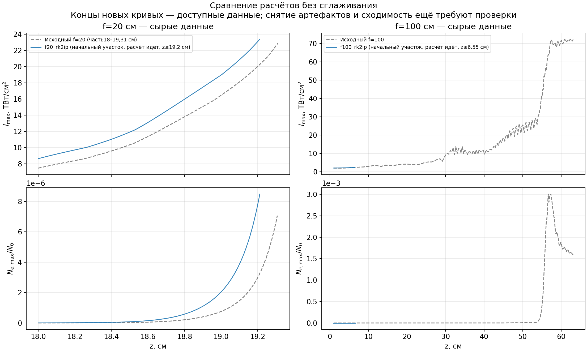
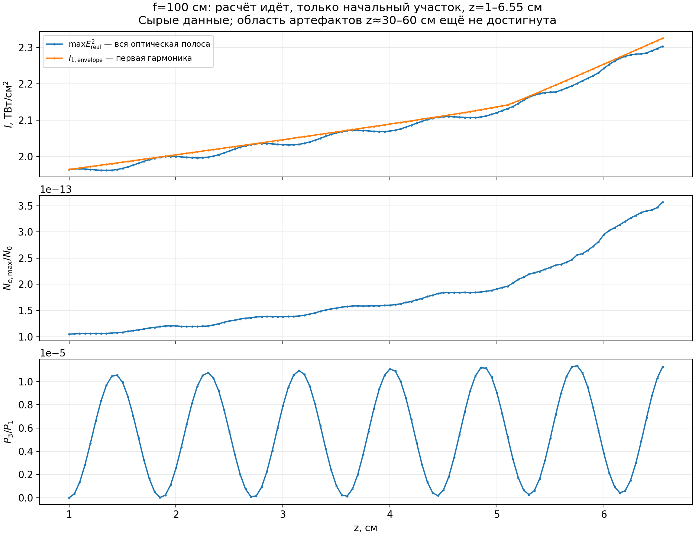

# Прогресс расчётов UPPE

Снимок данных: **20.10.2026 13:21 CEST**. Это сохранённый снимок, а не автоматически обновляемая страница.

Оба новых расчёта ещё идут. Область прежних колебаний для f=100 см пока не достигнута; полная нелинейная сходимость не подтверждена.

| Расчёт | Последний записанный z, см | Цель z, см | Точек |
|---|---:|---:|---:|
| f20_rk2ip | 19.21167 | 22 | 223 |
| f100_rk2ip | 6.55000 | 110 | 112 |

## Графики

[Скачать сравнение PNG](original_vs_current.png?raw=1) · [Скачать PDF](original_vs_current.pdf?raw=1)



[Диагностика f100: огибающая, Ne и третья гармоника](f100_current_diagnostics.png?raw=1)



## Условия и ограничения

- Новые запуски: rk2ip, dz ≤ 0.05 см, плазменная фаза ≤ 0.0025 рад; расчёты начаты заново.
- Синяя кривая — доступный участок нового расчёта; серый пунктир — исходные данные. Сглаживание не применяется.
- Доступный исходный f20 покрывает только z=18–19.3107 см. Это не полный график пользователя до 20.79 см.
- Старый f20 использует I0=166.2844 ГВт/см², новый — 192.5520 ГВт/см² после исправления нормировки энергии. Разницу амплитуд нельзя приписывать только интегратору.
- f100 имеет энергию 5 мДж и prelens=0, f20 — 0.5 мДж и prelens=400 см; это разные физические условия.
- Imax.dat содержит max(E_real²)/I0; Ne приведена к N0. Новая огибающая основной гармоники — отдельная спектральная диагностика.
- Все новые скалярные файлы обрезаны к общему полностью записанному набору z перед построением графиков.
- Реализация интегратора изменена локально и не публикуется в этой ветке снимков. Идентификаторы исходного состояния и хеши архивов кода записаны в manifest.json.

## Данные и воспроизведение

Данные находятся в `f20_rk2ip/res/`, `f100_rk2ip/res/` и `original/`. Нормировка и размеры сеток — в parameters.dat, шаги и фазы — в steps.dat.

Источники исходных результатов: [provenance.json](original/provenance.json).

Для воспроизведения PNG/PDF нужны Python, NumPy и Matplotlib:

```sh
python3 plot_focus_comparison.py --root . --auto --output .
```
