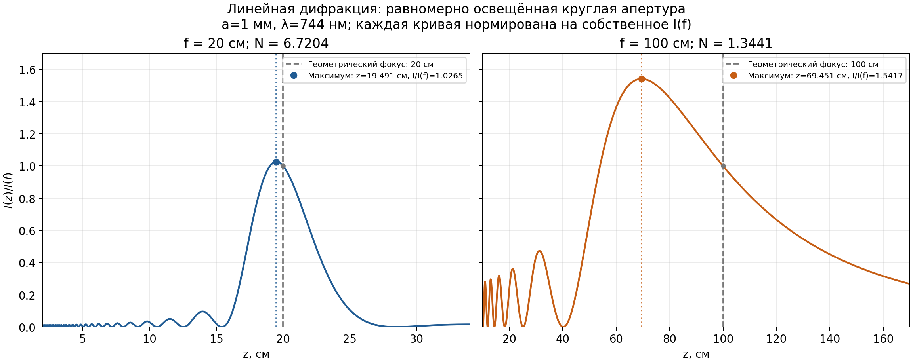
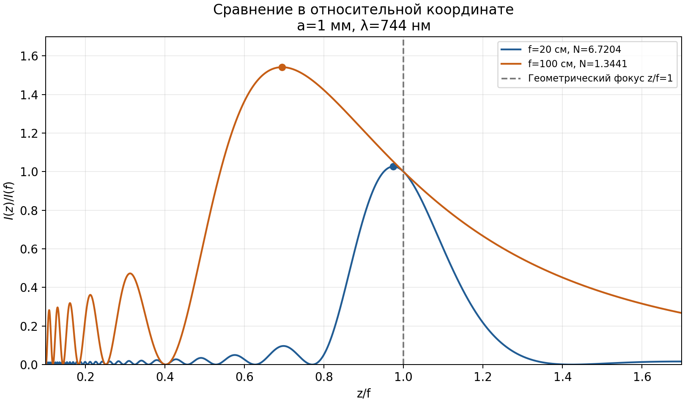

# Осевое распределение интенсивности: f=20 см и f=100 см

Построена аналитическая функция линейной параксиальной дифракции для равномерно освещённой круглой апертуры и идеальной тонкой линзы.

**Освещённый радиус a=1 мм (диаметр 2 мм), длина волны λ=744 нм.**

$$\frac{I(z)}{I(f)}=\left(\frac{f}{z}\right)^2\operatorname{sinc}^2\left[\frac{\pi N}{2}\left(\frac{f}{z}-1\right)\right],\qquad N=\frac{a^2}{\lambda f},\quad\operatorname{sinc}x=\frac{\sin x}{x}.$$



[Открыть PNG](fresnel_focus_f20_f100.png?raw=1) · [PDF](fresnel_focus_f20_f100.pdf?raw=1) · [Данные CSV](fresnel_focus.csv?raw=1)

| f, см | N | z максимума, см | Imax/I(f) | Сдвиг относительно f, см |
|---:|---:|---:|---:|---:|
| 20 | 6.720430 | 19.491224 | 1.026507 | -0.508776 |
| 100 | 1.344086 | 69.451307 | 1.541672 | -30.548693 |

Серая штриховая линия — геометрический фокус. Цветная точка и пунктир — максимум интенсивности.

**Каждая кривая нормирована на собственное I(f).** Это не сравнение абсолютных интенсивностей двух линз при одинаковом входном пучке.

При одинаковой входной интенсивности Iin: I(f)/Iin=(πN)². Значения максимумов Imax/Iin — примерно 457.5682 для f20 и 27.4882 для f100.

Модель описывает равномерный диск и линейное распространение. Нелинейные расчёты UPPE с супергауссовым пучком представлены в соседней папке progress.

## Сравнение в координате z/f



## Воспроизведение

Нужны Python, NumPy, Matplotlib и SciPy.

```sh
python3 plot_fresnel_focus.py --output .
```

Проверены I(f)/I(f)=1, конечность значений, положение максимумов и производная d[I(z)/I(f)]/dz при z=f, равная −2/f.

Построено 21.10.2026 16:42 CEST.
